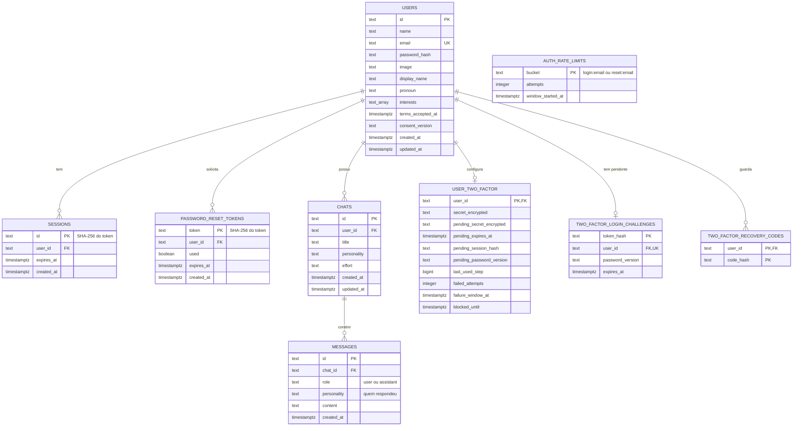

# Banco de dados

PostgreSQL (desenvolvimento local e testes: 17.7; produção: Neon). O
esquema completo, idempotente, está em [`backend/schema.sql`](../backend/schema.sql);
o acesso é feito com SQL parametrizado em `backend/db.py` (sem ORM - ver
`processo.md`).

## 1. Modelo conceitual

| Entidade | O que representa | Por que existe |
|---|---|---|
| Usuário | A pessoa com conta: identificação, senha (hash), perfil e aceite dos termos. | Base de tudo: as conversas e os dados pessoais pertencem a alguém. |
| Sessão | Um login ativo num navegador. | Manter a pessoa conectada sem reenviar a senha, e poder encerrar sessões (logout, troca de senha). |
| Token de redefinição | Um link de "esqueci a senha" emitido. | Provar que quem redefine a senha controla o e-mail, com validade e uso único. |
| Conversa | Um diálogo com a IA, com título, persona e nível de esforço. | Organizar o histórico e permitir retomar depois. |
| Mensagem | Uma fala da pessoa ou da IA dentro de uma conversa. | É o histórico enviado à IA e mostrado na tela. |
| Configuração de 2FA | Segredo TOTP (cifrado), ativação pendente e contadores de erro. | Segundo fator opcional, isolado dos dados comuns do usuário. |
| Desafio de login 2FA | O "meio do caminho" entre senha correta e código informado. | Não criar sessão só com a senha quando a conta tem 2FA. |
| Código de recuperação | Código reserva de uso único (guardado como hash). | Entrar se perder o celular com o autenticador. |
| Limite de tentativas | Contador de falhas de login e pedidos de redefinição por e-mail. | Barrar força bruta e envio de e-mails em massa. |

Relacionamentos: um usuário **tem** 0..N sessões, 0..N tokens de
redefinição, 0..N conversas, 0..1 configuração de 2FA, 0..1 desafio de login
pendente e 0..N códigos de recuperação; uma conversa **contém** 0..N
mensagens. O limite de tentativas **não** se relaciona com usuário (ver 5.6).

## 2. Diagrama entidade-relacionamento (DER)



## 3. Modelo lógico

```
users(id PK, name, email UNIQUE, password_hash, image, display_name, pronoun, interests[],
      terms_accepted_at, consent_version, created_at, updated_at)
sessions(id PK, user_id FK→users ON DELETE CASCADE, expires_at, created_at)
password_reset_tokens(token PK, user_id FK→users CASCADE, used, expires_at, created_at)
chats(id PK, user_id FK→users CASCADE, title, personality, effort, created_at, updated_at)
messages(id PK, chat_id FK→chats CASCADE, role CHECK(role IN ('user','assistant')),
         personality, content, created_at)
user_two_factor(user_id PK FK→users CASCADE, secret_encrypted, pending_secret_encrypted,
                pending_expires_at, pending_session_hash, pending_password_version,
                last_used_step, failed_attempts, failure_window_at, blocked_until)
two_factor_login_challenges(token_hash PK, user_id UNIQUE FK→users CASCADE,
                            password_version, expires_at)
two_factor_recovery_codes(user_id FK→users CASCADE, code_hash, PK(user_id, code_hash))
auth_rate_limits(bucket PK, attempts CHECK(attempts > 0), window_started_at)
```

## 4. Dicionário de dados

Nulo = "sim" quando a coluna aceita `NULL`. Todas as datas são `TIMESTAMPTZ`
(com fuso), gravadas pelo próprio PostgreSQL (`now()`).

### users
| Coluna | Tipo | Nulo | Padrão | Descrição |
|---|---|---|---|---|
| id | TEXT | não | — | Identificador aleatório (24 hex, `db.new_id`). PK. |
| name | TEXT | não | — | Nome da conta (2-100 caracteres na API). |
| email | TEXT | não | — | E-mail em minúsculas. UNIQUE. |
| password_hash | TEXT | não | — | Hash da senha (Werkzeug: algoritmo + sal + hash). Nunca sai da API. |
| image | TEXT | sim | — | Avatar: `avatar:<id>` (ilustrado) ou data-URL de foto ≤ 350 mil caracteres. |
| display_name | TEXT | sim | — | Apelido (≤ 50). Enviado à IA. |
| pronoun | TEXT | sim | — | Pronome (≤ 30). Enviado à IA. |
| interests | TEXT[] | não | `'{}'` | Até 25 interesses de até 60 caracteres. Enviado à IA. |
| terms_accepted_at | TIMESTAMPTZ | sim | — | Quando aceitou os termos (prova de consentimento, LGPD). |
| consent_version | TEXT | sim | — | Versão aceita (`auth.CONSENT_VERSION`). Diferente da atual = pedir novo aceite. |
| created_at / updated_at | TIMESTAMPTZ | não | `now()` | Criação / última alteração do perfil ou senha. |

### sessions
| Coluna | Tipo | Nulo | Descrição |
|---|---|---|---|
| id | TEXT | não | SHA-256 do token que está no cookie. PK. |
| user_id | TEXT | não | Dono. FK → users, CASCADE. |
| expires_at | TIMESTAMPTZ | não | Login + 30 dias. Vencidas são apagadas a cada novo login. |
| created_at | TIMESTAMPTZ | não | — |

### password_reset_tokens
| Coluna | Tipo | Nulo | Descrição |
|---|---|---|---|
| token | TEXT | não | SHA-256 do token do link. PK. |
| user_id | TEXT | não | FK → users, CASCADE. |
| used | BOOLEAN | não | Marcado no uso (uso único). |
| expires_at | TIMESTAMPTZ | não | Emissão + 1 hora. |
| created_at | TIMESTAMPTZ | não | — |

### chats
| Coluna | Tipo | Nulo | Padrão | Descrição |
|---|---|---|---|---|
| id | TEXT | não | — | PK aleatória. |
| user_id | TEXT | não | — | Dono. FK → users, CASCADE. |
| title | TEXT | não | `'New Chat'` | Primeira mensagem (40 caracteres) ou nome dado pela pessoa (≤ 100). |
| personality | TEXT | não | `'trashtalker'` | Persona atual: `trashtalker` ou `mathias` (validado na API). |
| effort | TEXT | não | `'trash'` | Nível de esforço: `trash` ou `talker` (validado na API). |
| created_at / updated_at | TIMESTAMPTZ | não | `now()` | `updated_at` ordena a barra lateral. |

### messages
| Coluna | Tipo | Nulo | Descrição |
|---|---|---|---|
| id | TEXT | não | PK aleatória. |
| chat_id | TEXT | não | FK → chats, CASCADE. |
| role | TEXT | não | `user` ou `assistant` (CHECK). |
| personality | TEXT | sim | Persona que escreveu a resposta; `NULL` em mensagens do usuário e em respostas antigas (anteriores à coluna). |
| content | TEXT | não | Texto (mensagem do usuário: 1-8000 caracteres). |
| created_at | TIMESTAMPTZ | não | Ordena o histórico. |

### user_two_factor (1:0..1 com users)
| Coluna | Tipo | Nulo | Descrição |
|---|---|---|---|
| user_id | TEXT | não | PK e FK → users, CASCADE. |
| secret_encrypted | TEXT | sim | Segredo TOTP ativo, cifrado com Fernet (`TOTP_ENCRYPTION_KEY`). `NULL` = 2FA desligado. |
| pending_secret_encrypted / pending_expires_at | TEXT / TIMESTAMPTZ | sim | Ativação em andamento (10 min). |
| pending_session_hash / pending_password_version | TEXT | sim | Prende a ativação à sessão e à senha que a iniciaram. |
| last_used_step | BIGINT | não (-1) | Último intervalo de 30 s aceito (impede reutilizar código). |
| failed_attempts / failure_window_at / blocked_until | INTEGER / TIMESTAMPTZ | não/sim | Limite de 5 erros em 15 min. |

### two_factor_login_challenges
| Coluna | Tipo | Nulo | Descrição |
|---|---|---|---|
| token_hash | TEXT | não | SHA-256 do desafio entregue ao navegador. PK. |
| user_id | TEXT | não | FK → users, CASCADE. UNIQUE: um desafio pendente por conta. |
| password_version | TEXT | não | Hash do hash da senha: trocar a senha invalida o desafio. |
| expires_at | TIMESTAMPTZ | não | 5 minutos. |

### two_factor_recovery_codes
| Coluna | Tipo | Nulo | Descrição |
|---|---|---|---|
| user_id | TEXT | não | FK → users, CASCADE. Parte da PK. |
| code_hash | TEXT | não | SHA-256 do código. Parte da PK. Usar = apagar a linha. |

### auth_rate_limits
| Coluna | Tipo | Nulo | Descrição |
|---|---|---|---|
| bucket | TEXT | não | `login:<email>` ou `reset:<email>`. PK. |
| attempts | INTEGER | não | Ocorrências na janela (CHECK > 0). |
| window_started_at | TIMESTAMPTZ | não | Início da janela; linhas com mais de 1 dia são apagadas na próxima ocorrência. |

## 5. Decisões de modelagem (e o que uma banca pode perguntar)

### 5.1 Por que chaves `TEXT` aleatórias e não `SERIAL`?
Ids sequenciais (1, 2, 3…) revelam quantos usuários e conversas existem e
convidam a "chutar" o id de outra pessoa na URL (`/dashboard/chat/42`). O
id aleatório de 96 bits (`secrets.token_hex(12)`) não é adivinhável, e
mesmo assim toda rota confere o dono (RNF02). *Evolução possível:* o tipo
nativo `UUID` ocuparia menos espaço que o texto hexadecimal.

### 5.2 Por que `ON DELETE CASCADE` em todas as chaves estrangeiras?
A exclusão da conta (LGPD) precisa apagar **tudo** de uma vez e sem deixar
órfãos. Com o CASCADE, apagar a linha de `users` apaga sessões, tokens,
conversas → mensagens e dados de 2FA, numa única operação atômica do banco.
Testado em `test_excluir_conta_remove_tudo_em_cascata` e
`test_excluir_conta_limpa_tabelas_2fa`.

### 5.3 Por que `interests` é um array (`TEXT[]`) e não uma tabela?
Estritamente, um atributo multivalorado foge da 1ª forma normal. A escolha
foi deliberada: a lista é pequena (≤ 25), é sempre lida e gravada inteira,
a ordem importa e nunca se consulta "quem gosta de X". Uma tabela
`user_interests(user_id, posicao, interesse)` seria a forma normalizada -
e passa a valer a pena se surgir uma consulta por interesse.

### 5.4 Por que a foto fica no próprio banco (`users.image`)?
Evita um serviço extra de armazenamento de arquivos. O custo foi limitado:
o navegador reduz a foto para 256 px (alguns KB), o servidor recusa mais de
350 mil caracteres e só aceita formatos de imagem conhecidos, e a foto não é
carregada nas requisições comuns (só no painel e em `/api/me`). *Evolução:*
guardar o arquivo num armazenamento de objetos e manter só a URL.

### 5.5 Por que `personality` e `effort` são `TEXT` sem tabela nem CHECK?
As personas são definidas **no código**, junto com o prompt de cada uma
(`personalities.py`); acrescentar uma persona exige código de qualquer jeito.
A API recusa valores desconhecidos na escrita e o código usa um padrão
seguro na leitura. *Alternativa:* `CHECK (personality IN (...))` - mais
rígido, mas exigiria migração a cada persona nova.

### 5.6 Por que `auth_rate_limits` não tem chave estrangeira para `users`?
Porque precisa contar tentativas também para e-mails **sem** conta - senão a
diferença de comportamento revelaria quais e-mails estão cadastrados. Por
isso a exclusão da conta apaga essas linhas explicitamente
(`auth.forget_rate_limits`), não por CASCADE.

### 5.7 Por que tokens e códigos guardados como hash?
Sessões, links de redefinição, desafios e códigos de recuperação são
"senhas temporárias". Guardando só o SHA-256, uma cópia do banco (backup,
vazamento) não permite entrar em nenhuma conta. O segredo TOTP é diferente:
o servidor precisa dele para calcular o código, então ele é **cifrado**
(Fernet) com uma chave que fica fora do banco.

### 5.8 Como a integridade é garantida
| Mecanismo | Onde |
|---|---|
| Chaves primárias e `UNIQUE` (e-mail; um desafio 2FA por conta) | todas as tabelas |
| Chaves estrangeiras com CASCADE (7) | tabelas filhas de `users` e `chats` |
| `CHECK` (`messages.role`, `auth_rate_limits.attempts`) | `schema.sql` |
| `NOT NULL` + `DEFAULT` nos campos obrigatórios | `schema.sql` |
| Transações com `SELECT … FOR UPDATE` no 2FA | `two_factor.py` |
| Operações atômicas contra corrida: `INSERT … ON CONFLICT`, `UPDATE … RETURNING` | cadastro, link de redefinição, limite de tentativas |
| Validação de formato e tamanho antes de gravar | `validation.py`, rotas |

### 5.9 Índices
| Índice | Consulta que atende |
|---|---|
| `idx_messages_chat_created (chat_id, created_at)` | histórico de uma conversa em ordem; últimas 40 para a IA |
| `idx_chats_user_updated (user_id, updated_at DESC)` | barra lateral |
| `idx_sessions_user_id`, `idx_sessions_expires_at` | derrubar sessões de uma conta; faxina das vencidas |
| `idx_password_reset_tokens_user_id` | invalidar links anteriores da conta |
| `idx_chats_user_id`, `idx_messages_chat_id` | antigos; hoje cobertos pelos compostos acima (mantidos por não haver ganho em removê-los num banco pequeno) |

### 5.10 Evolução do modelo
`schema.sql` só cresce de forma compatível (`ADD COLUMN IF NOT EXISTS`,
`CREATE … IF NOT EXISTS`, constraint em bloco `DO`), então rodá-lo de novo
atualiza qualquer banco antigo sem apagar dados (RNF14). Se o projeto
crescer, o próximo passo natural é uma ferramenta de migração versionada
(ex.: Alembic) - hoje desnecessária (`processo.md`, R-09).

## 6. Scripts e dados

| Arquivo | Para quê |
|---|---|
| `backend/schema.sql` | Cria/atualiza o esquema: `psql "$DATABASE_URL" -v ON_ERROR_STOP=1 -f backend/schema.sql` |
| `tools/seed_demo.py` | Conta de demonstração com duas conversas (respostas com texto fixo, **não** geradas pela IA). Recusa produção. `python -m tools.seed_demo` |
| `tests/conftest.py`, `features/environment.py` | Aplicam o esquema no banco de teste e o zeram a cada caso. |

Consulta útil para conferir a estrutura num banco real:

```sql
SELECT table_name, column_name, data_type, is_nullable, column_default
FROM information_schema.columns
WHERE table_schema = 'public'
ORDER BY table_name, ordinal_position;
```
