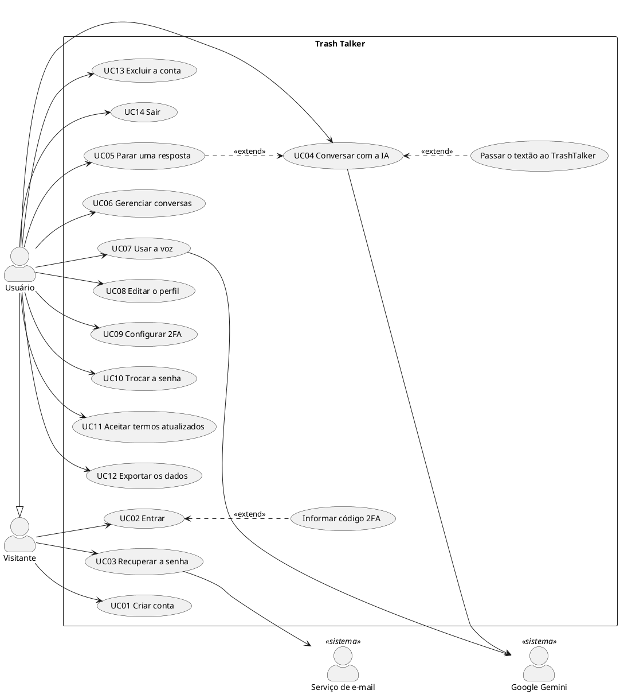

# Casos de uso

Descrevem como cada ator usa o sistema **como ele foi implementado**. Os
números de regra (RN) e requisito (RF) estão em [`requisitos.md`](requisitos.md).

## Atores

| Ator | Tipo | Descrição |
|---|---|---|
| Visitante | Primário | Pessoa sem sessão. Vê a página inicial e as páginas legais, cria conta, entra, recupera a senha. |
| Usuário | Primário | Pessoa com sessão ativa (18+, com aceite registrado). Conversa, gerencia conta e dados. |
| Google Gemini | Secundário (sistema externo) | Gera as respostas em texto e o áudio. Chamado só pelo servidor. |
| Serviço de e-mail (SMTP) | Secundário (sistema externo) | Entrega o link de redefinição de senha. |

O Usuário é uma especialização do Visitante. Não existe ator administrador:
o sistema não tem painel de administração (ver escopo em `tcc/projeto.md`).

## Visão geral

| UC | Nome | Ator | RF |
|---|---|---|---|
| UC01 | Criar conta | Visitante | RF01 |
| UC02 | Entrar (com ou sem 2FA) | Visitante | RF02, RF04 |
| UC03 | Recuperar a senha | Visitante, Serviço de e-mail | RF03 |
| UC04 | Conversar com a IA | Usuário, Google Gemini | RF06, RF07 |
| UC05 | Parar uma resposta | Usuário | RF08 |
| UC06 | Gerenciar conversas | Usuário | RF05 |
| UC07 | Usar a voz | Usuário, Google Gemini | RF12 |
| UC08 | Editar o perfil | Usuário | RF09 |
| UC09 | Configurar a autenticação em dois fatores | Usuário | RF04 |
| UC10 | Trocar a senha | Usuário | RF10 |
| UC11 | Aceitar os termos atualizados | Usuário | RF11 |
| UC12 | Exportar os dados | Usuário | RF11 |
| UC13 | Excluir a conta | Usuário | RF11 |
| UC14 | Sair | Usuário | RF02 |

---

## UC01 — Criar conta
- **Ator:** Visitante. **Objetivo:** ter uma conta para conversar.
- **Pré-condições:** nenhuma.
- **Fluxo principal:**
  1. O visitante abre "Criar conta" e informa e-mail, nome, senha e confirmação.
  2. O sistema mostra, enquanto ele digita, quais regras de senha (RN01) já foram cumpridas.
  3. O visitante marca as duas confirmações (18+/termos e envio à IA) e envia.
  4. O sistema cria a conta, registra data e versão do aceite e leva ao login com o aviso "Conta criada".
- **Fluxos alternativos:** A1 - senhas diferentes ou regra de senha não cumprida: o sistema avisa antes de enviar.
- **Exceções:** E1 - e-mail já cadastrado: "Este email já está cadastrado". E2 - confirmação desmarcada: o sistema pede as duas. E3 - servidor fora: "Não foi possível conectar ao servidor".
- **Pós-condições:** conta criada, **sem** sessão (RN04).

## UC02 — Entrar
- **Ator:** Visitante. **Objetivo:** acessar as próprias conversas.
- **Pré-condições:** conta existente.
- **Fluxo principal:**
  1. O visitante informa e-mail e senha.
  2. O sistema valida e cria a sessão (cookie de 30 dias).
  3. O sistema abre o painel com a lista de conversas.
- **Fluxos alternativos:** A1 - conta com 2FA: depois da senha o sistema pede o código do aplicativo (ou um código de recuperação); só então cria a sessão. A2 - conta sem o aceite atual: entra normalmente e o UC11 é oferecido.
- **Exceções:** E1 - credenciais erradas: "Email ou senha incorretos" (sem dizer qual). E2 - 10 erros em 15 min: "Muitas tentativas…" (RN08). E3 - código 2FA errado/usado: mensagem e nova tentativa; 5 erros bloqueiam (RN09). E4 - verificação 2FA expirada (5 min): volta à senha.
- **Pós-condições:** sessão ativa.

## UC03 — Recuperar a senha
- **Atores:** Visitante, Serviço de e-mail. **Objetivo:** voltar a entrar sem a senha antiga.
- **Pré-condições:** nenhuma.
- **Fluxo principal:**
  1. O visitante informa o e-mail em "Esqueceu a senha?".
  2. O sistema responde sempre "Se o e-mail informado estiver cadastrado, você receberá um link para redefinir sua senha."
  3. Se a conta existe, o sistema gera um link de 1 hora e o Serviço de e-mail o entrega.
  4. O visitante abre o link, define a nova senha e é levado ao login com o aviso "Senha redefinida".
  5. O sistema encerra todas as sessões abertas da conta (RN07).
- **Exceções:** E1 - link vencido, usado ou substituído por um mais novo: "Link inválido ou expirado" com opção de pedir outro. E2 - mais de 3 pedidos na hora: nada é enviado, a resposta não muda. E3 - SMTP fora do ar: em desenvolvimento o link aparece no terminal; em produção, só o aviso no log.
- **Pós-condições:** senha trocada; 2FA, se ativo, continua ativo.

## UC04 — Conversar com a IA
- **Atores:** Usuário, Google Gemini. **Objetivo:** desabafar, ensaiar uma situação ou pedir orientação.
- **Pré-condições:** sessão ativa; aceite da versão atual dos termos.
- **Fluxo principal:**
  1. O usuário escolhe (opcional) a persona e o esforço e escreve a mensagem.
  2. O sistema grava a mensagem, monta o contexto (persona, perfil, últimas 40 mensagens) e envia ao Gemini.
  3. Durante a espera, o campo fica bloqueado e o botão vira "parar" (UC05).
  4. O sistema grava a resposta com a persona que a escreveu e a mostra.
  5. Na primeira mensagem, o título da conversa passa a ser o início dela.
- **Fluxos alternativos:** A1 - persona MathIAs e mensagem com mais de 800 caracteres: o MathIAs responde com a fala de passagem, o TrashTalker responde e assume a conversa (RN15). A2 - nova conversa: começa no painel; a conversa é criada no primeiro envio.
- **Exceções:** E1 - mensagem vazia ou acima de 8000 caracteres: recusada sem chamar a IA. E2 - Gemini indisponível/bloqueado: aviso "A resposta falhou…", a mensagem fica salva e não é reenviada sozinha. E3 - aceite pendente: o sistema pede o novo aceite (UC11).
- **Pós-condições:** mensagem e resposta no histórico.

## UC05 — Parar uma resposta
- **Ator:** Usuário. **Objetivo:** desistir de uma mensagem já enviada.
- **Pré-condições:** uma resposta em andamento (UC04, passo 3).
- **Fluxo principal:** 1. O usuário clica em "parar". 2. O sistema apaga a mensagem que estava sendo respondida e devolve o texto ao campo. 3. Se a resposta chegar depois, é descartada.
- **Exceções:** E1 - não foi possível confirmar o cancelamento: o sistema avisa, mantém o rascunho e oferece reabrir a conversa para conferir.
- **Pós-condições:** a conversa fica como antes do envio (inclusive o título).

## UC06 — Gerenciar conversas
- **Ator:** Usuário. **Objetivo:** reencontrar, organizar ou apagar conversas.
- **Pré-condições:** sessão ativa.
- **Fluxo principal:** 1. O usuário vê a lista na barra lateral (mais recente primeiro). 2. Abre uma conversa e o histórico aparece com o autor de cada resposta. 3. Pode renomear (1 a 100 caracteres) ou excluir (com confirmação).
- **Exceções:** E1 - conversa inexistente ou de outra pessoa: a API responde 404 e a tela volta ao painel. E2 - título vazio: recusado.
- **Pós-condições:** lista atualizada; conversa excluída some com todas as mensagens.

## UC07 — Usar a voz
- **Atores:** Usuário, Google Gemini. **Objetivo:** falar em vez de digitar e ouvir as respostas.
- **Pré-condições:** sessão ativa; navegador com reconhecimento de fala (para ditar).
- **Fluxo principal:** 1. O usuário toca no microfone e fala; o texto aparece no campo. 2. Revisa e envia (UC04). 3. Toca em "ouvir" numa resposta; o sistema pede o áudio ao Gemini com a voz da persona e toca.
- **Exceções:** E1 - navegador sem ditado (ex.: Firefox): o botão não aparece. E2 - permissão do microfone negada: mensagem explicando. E3 - áudio do Gemini falhou ou demorou mais de 30 s: o navegador lê com a própria voz.
- **Pós-condições:** nenhuma gravação de áudio no servidor.

## UC08 — Editar o perfil
- **Ator:** Usuário. **Objetivo:** ser chamado do jeito certo e ter respostas mais próximas.
- **Pré-condições:** sessão ativa.
- **Fluxo principal:** 1. O usuário abre "Conta". 2. Muda nome, avatar (ilustrado ou foto), apelido, pronome e interesses. 3. Salva; o sistema confirma e atualiza a barra lateral.
- **Fluxos alternativos:** A1 - foto: o navegador a reduz para 256 px e remove metadados antes de enviar.
- **Exceções:** E1 - campo fora do limite (RN19): mensagem do campo. E2 - imagem em formato não aceito: "Imagem inválida ou grande demais".
- **Pós-condições:** a IA passa a usar apelido, pronome e interesses nas próximas respostas.

## UC09 — Configurar a autenticação em dois fatores
- **Ator:** Usuário. **Objetivo:** proteger a conta além da senha.
- **Pré-condições:** sessão ativa; servidor com `TOTP_ENCRYPTION_KEY`.
- **Fluxo principal:** 1. Em Configurações, o usuário inicia a ativação e confirma a senha. 2. O sistema mostra o QR code e a chave manual (válidos por 10 min). 3. O usuário lê no aplicativo e digita o código. 4. O sistema ativa, mostra 8 códigos de recuperação uma única vez e encerra as outras sessões.
- **Fluxos alternativos:** A1 - gerar novos códigos de recuperação (senha + código). A2 - desativar (senha + código).
- **Exceções:** E1 - código errado: nova tentativa; 5 erros bloqueiam 15 min. E2 - ativação vencida ou iniciada em outra sessão: recomeçar. E3 - chave do servidor ausente: "temporariamente indisponível".
- **Pós-condições:** próximos logins exigem o código (UC02, A1).

## UC10 — Trocar a senha
- **Ator:** Usuário. **Pré-condições:** sessão ativa.
- **Fluxo principal:** 1. Informa a senha atual e a nova (com confirmação). 2. O sistema troca e encerra as sessões dos outros dispositivos, mantendo a atual.
- **Exceções:** E1 - senha atual errada. E2 - nova senha fora da RN01.

## UC11 — Aceitar os termos atualizados
- **Ator:** Usuário. **Objetivo:** voltar a conversar após mudança relevante dos termos.
- **Pré-condições:** sessão ativa; aceite registrado com versão anterior (ou nenhum).
- **Fluxo principal:** 1. Ao abrir o painel, o sistema mostra a janela com as duas confirmações. 2. O usuário marca as duas e aceita. 3. O sistema registra data e versão.
- **Fluxos alternativos:** A1 - "Agora não": pode navegar, exportar e excluir a conta, mas não conversar; a janela volta no próximo carregamento.

## UC12 — Exportar os dados
- **Ator:** Usuário. **Pré-condições:** sessão ativa.
- **Fluxo principal:** 1. Em Configurações > Privacidade e dados, clica em "Exportar meus dados". 2. O navegador baixa `trash-talker-dados.json` com perfil, aceite, conversas e mensagens.
- **Pós-condições:** nenhum dado alterado; o arquivo não contém hash de senha nem segredos.

## UC13 — Excluir a conta
- **Ator:** Usuário. **Objetivo:** apagar todos os dados.
- **Pré-condições:** sessão ativa.
- **Fluxo principal:** 1. Em Configurações, clica em "Excluir conta". 2. Etapa 1: informa a senha. 3. Etapa 2: digita a frase "eu quero excluir essa conta". 4. Etapa 3: confirma. 5. O sistema apaga a conta e tudo ligado a ela e volta à página inicial.
- **Exceções:** E1 - senha errada ou frase diferente: nada é apagado; é preciso recomeçar.
- **Pós-condições:** conta, sessões, conversas, mensagens, dados de 2FA e registro de tentativas apagados.

## UC14 — Sair
- **Ator:** Usuário. **Fluxo principal:** clica em Sair; o sistema apaga a sessão e abre o login.

---

## Especificação do diagrama (PlantUML)

Cole em <https://www.plantuml.com/plantuml> ou num editor com PlantUML para
gerar a imagem. (A notação de caso de uso não existe em Mermaid.)

