# Manual do usuário

Como usar o Trash Talker. As imagens foram capturadas do sistema real em
2026-10-08, com a **conta de demonstração**: as conversas mostradas são texto
de exemplo criado para a demo (`tools/seed_demo.py`), não respostas geradas
pela IA.

> O Trash Talker é um companheiro de conversa com inteligência artificial.
> Ele **não substitui** ajuda profissional. Em crise, ligue para o CVV
> (188, grátis, 24 h) ou acesse cvv.org.br; em perigo imediato, 190 ou 192.

## 1. Acesso
- Abra o endereço do site **[PREENCHER: URL de produção]** num navegador
  atualizado (Chrome, Edge, Firefox ou Safari), no computador ou no celular.
- É preciso ter **18 anos ou mais**.

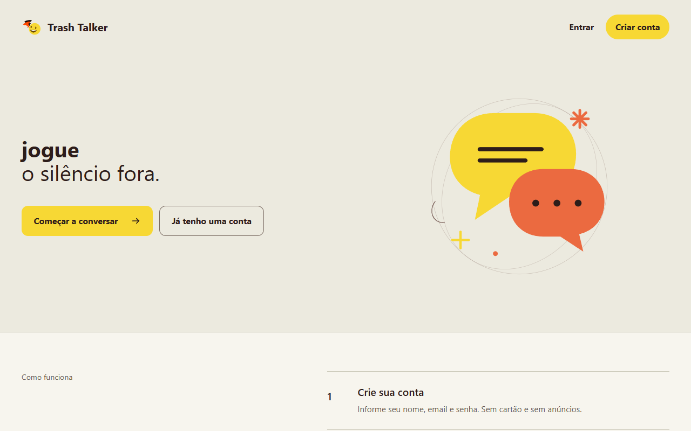

## 2. Criar conta
1. Clique em **Criar conta**.
2. Informe e-mail, nome e uma senha com pelo menos 8 caracteres, letra
   maiúscula, letra minúscula, número e caractere especial. A lista abaixo do
   campo mostra o que já foi cumprido.
3. Marque as duas confirmações: idade e termos, e o envio das mensagens ao
   Google Gemini. Sem elas a conta não é criada.
4. Clique em **Criar conta**. Você vai para a tela de entrada com o aviso
   "Conta criada! Agora é só entrar."

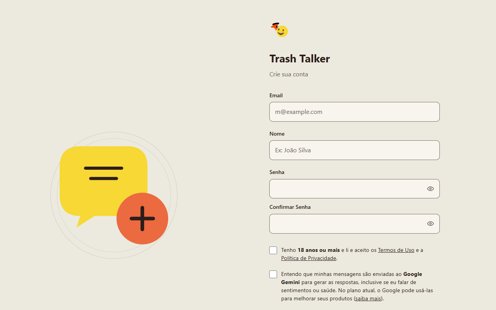

## 3. Entrar e sair
- Informe e-mail e senha e clique em **Entrar**. O ícone de olho mostra a senha.
- Se você ativou a autenticação em dois fatores, digite o código do aplicativo
  (ou um código de recuperação).
- Para sair, use o ícone de saída ao lado do seu nome, no canto inferior da
  barra lateral.

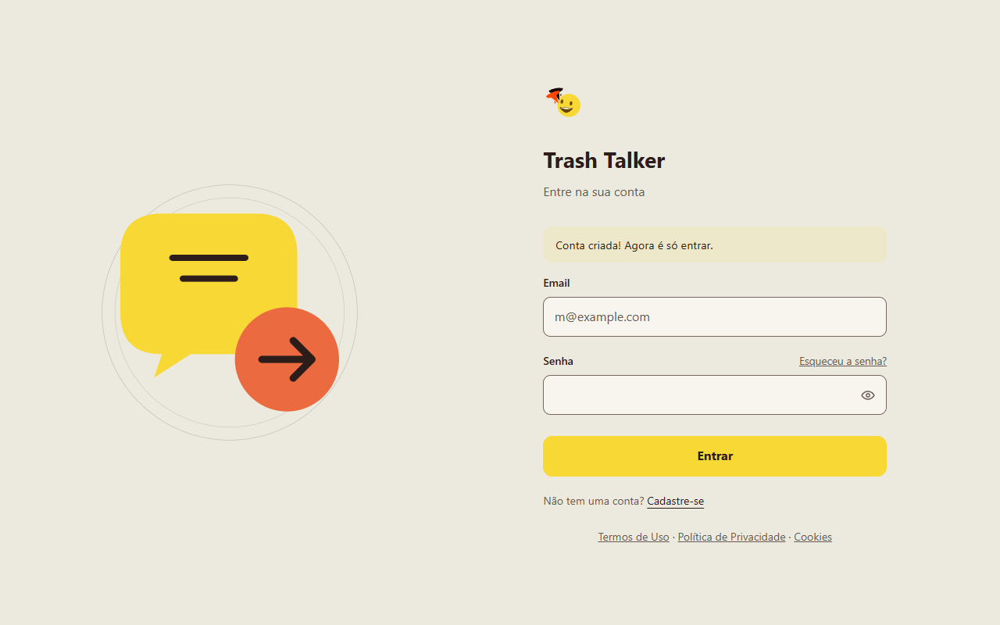

**Esqueceu a senha?** Clique em "Esqueceu a senha?", informe o e-mail e use o
link que chegar (vale 1 hora e uma vez só). Por segurança, a mensagem é a
mesma tenha ou não conta com aquele e-mail.

## 4. Conversar
1. No painel, escreva no campo **Mande uma mensagem...** e tecle **Enter**
   (Shift+Enter quebra a linha) ou clique na seta.
2. Enquanto a resposta é preparada, a seta vira um quadrado: clique nele para
   **parar e desfazer** o envio - o texto volta para o campo.
3. A conversa aparece na barra lateral com o início da primeira mensagem como
   título.

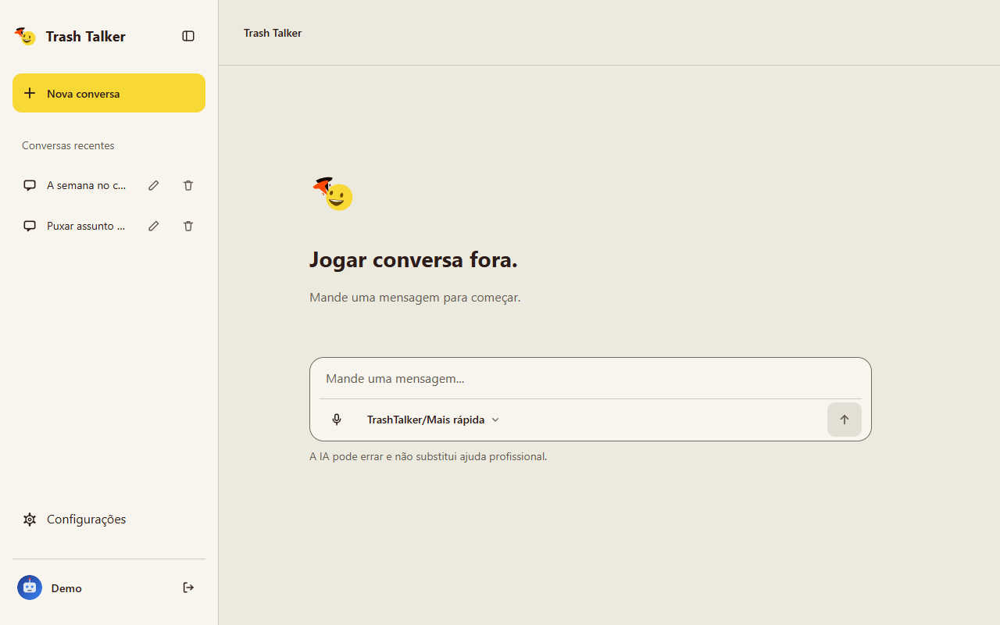
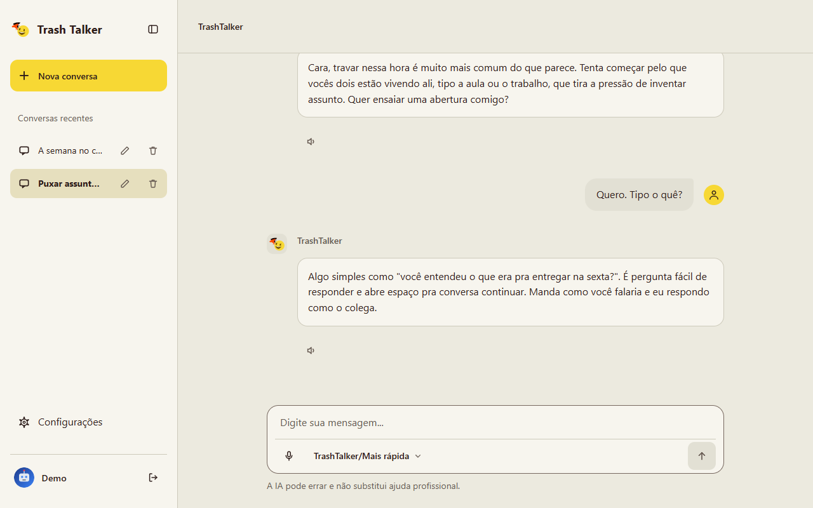

### Personalidade e esforço
No seletor dentro do campo de mensagem você escolhe:
- **TrashTalker** - o amigo que ajuda a descomplicar situações sociais, com
  conselhos práticos e ensaios de conversa.
- **MathIAs** - o amigo engraçado, para relaxar. Se você mandar um texto muito
  longo (mais de 800 caracteres), ele passa a conversa para o TrashTalker.
- **Mais rápida** ou **Mais elaborada** - quanto a IA "pensa" antes de responder.

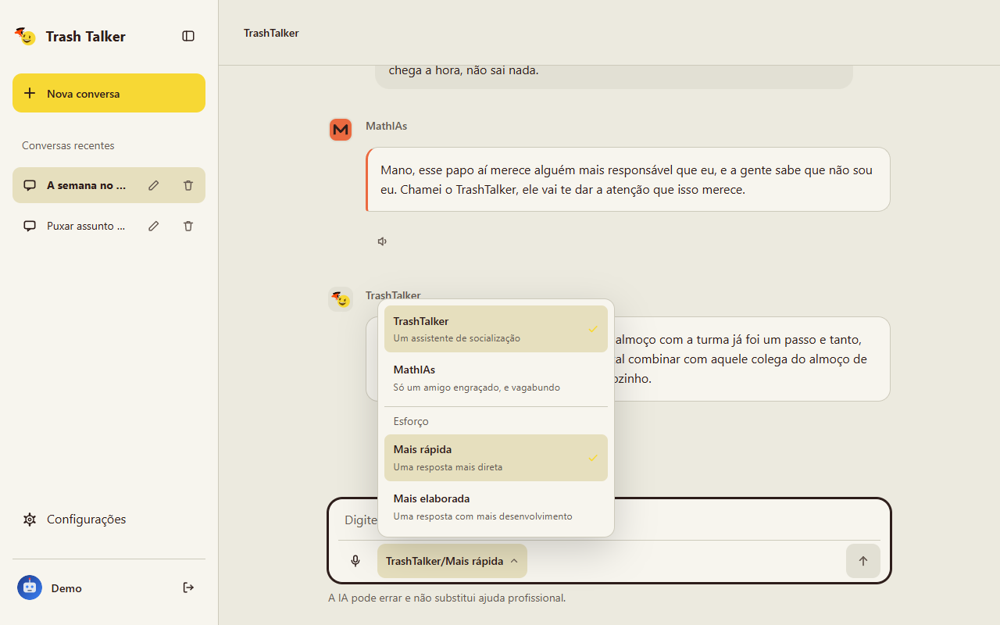
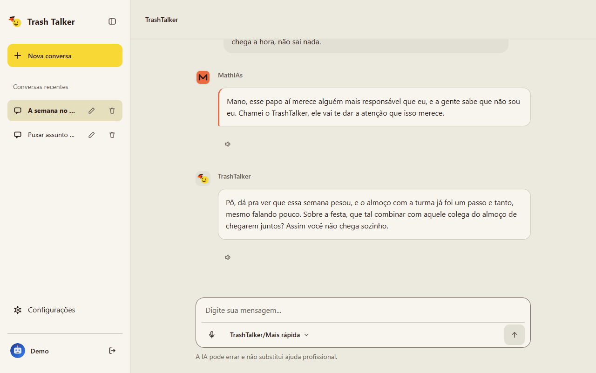

### Voz
- **Microfone** (Chrome, Edge e Safari): toque, fale e revise o texto antes de enviar.
- **Alto-falante** em cada resposta: ouve a resposta com a voz da persona.

### Organizar as conversas
Na barra lateral, cada conversa tem os botões **renomear** (lápis) e
**excluir** (lixeira). Excluir apaga a conversa e todas as mensagens.

## 5. Seu perfil
Em **Conta** (clique no seu nome na barra lateral) você escolhe um avatar
ilustrado ou envia uma foto, e informa apelido, pronome e interesses. A IA
usa apelido, pronome e interesses para conversar de um jeito mais próximo.

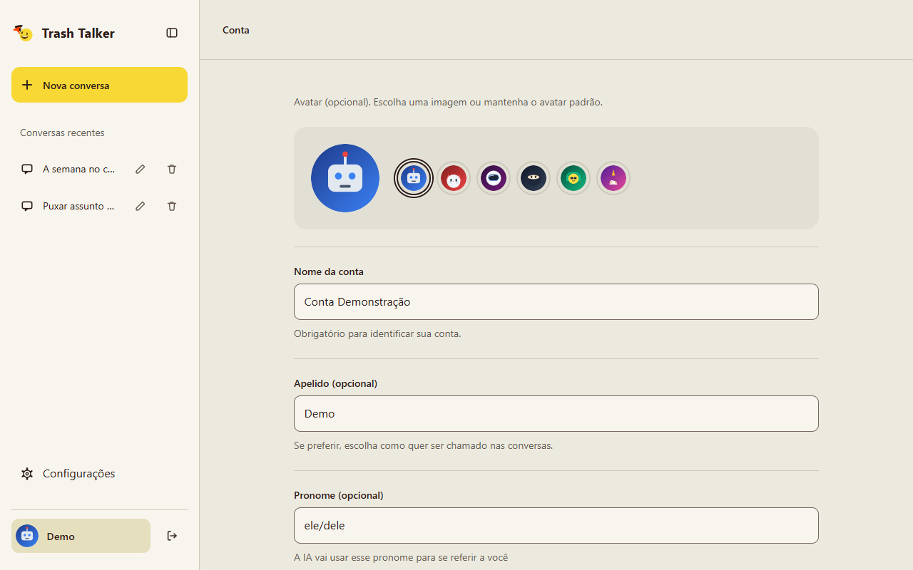

## 6. Configurações
- **Aparência:** tema claro ou escuro.
- **Alterar senha:** pede a senha atual; desconecta seus outros dispositivos.
- **Autenticação em dois fatores:** veja `docs/2fa.md`. Guarde os códigos de
  recuperação - sem eles e sem o aplicativo não há como entrar.
- **Privacidade e dados:** documentos legais e **Exportar meus dados** (baixa
  um arquivo JSON com seu perfil e suas conversas).
- **Excluir conta:** três etapas (senha, frase de confirmação, confirmação
  final). Apaga tudo e não pode ser desfeito.

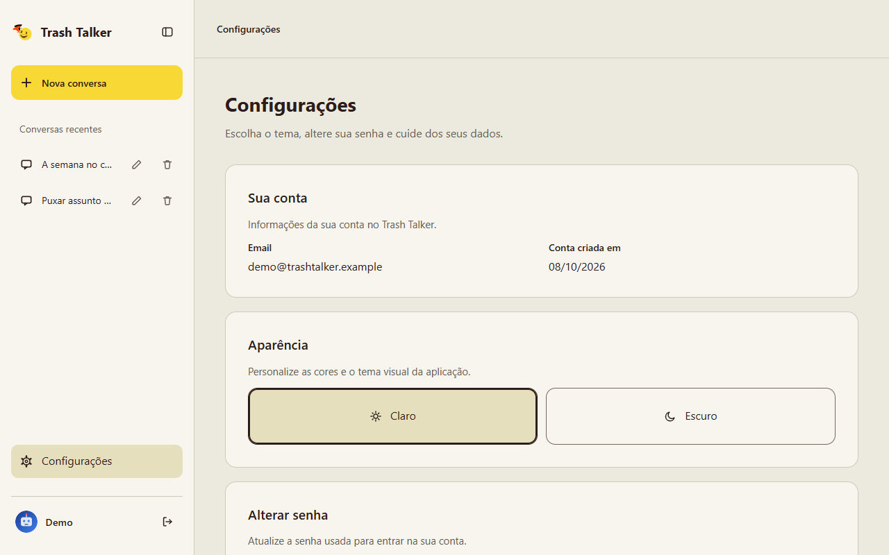
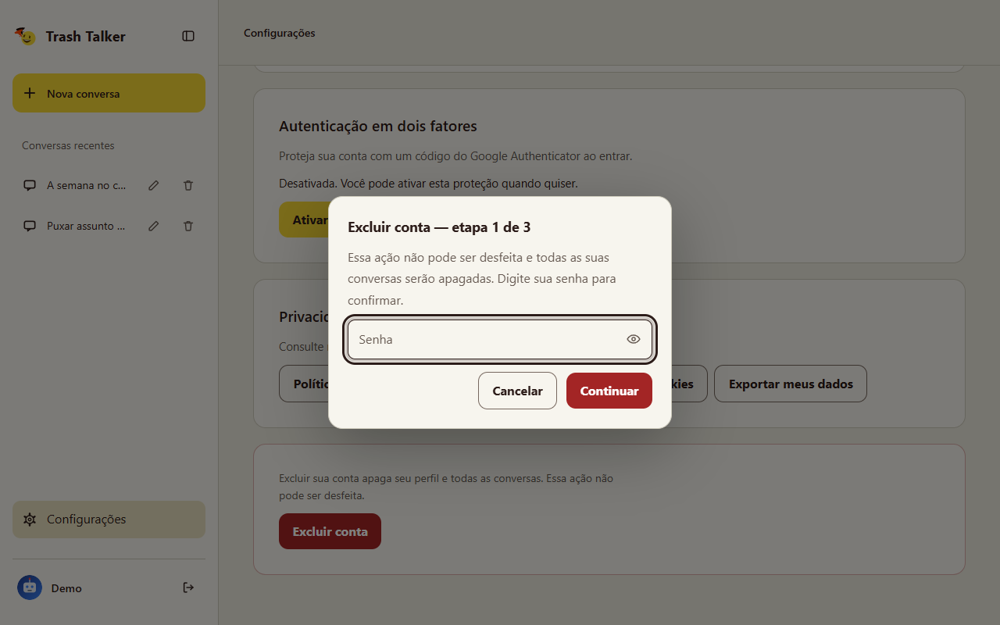

## 7. No celular
O menu fica no ícone do canto superior esquerdo.

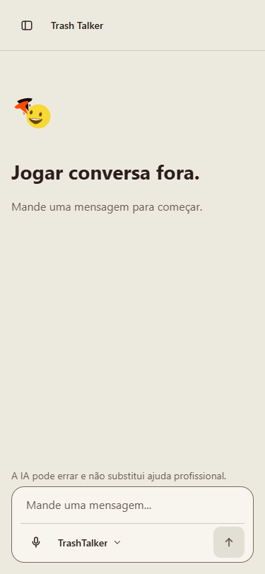
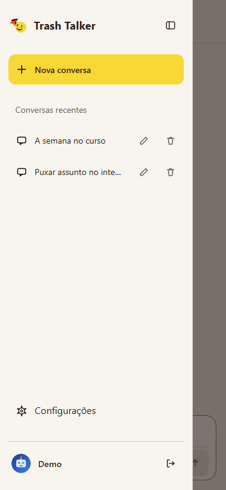
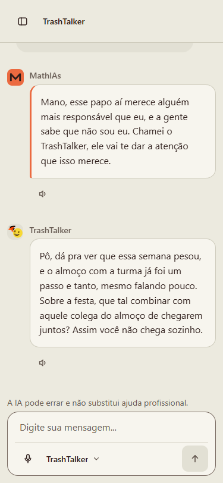

## 8. Mensagens que você pode ver
| Mensagem | O que significa | O que fazer |
|---|---|---|
| "Email ou senha incorretos" | Um dos dois está errado. | Confira; se esqueceu, use "Esqueceu a senha?". |
| "Muitas tentativas. Aguarde alguns minutos e tente de novo." | Muitas senhas erradas seguidas (proteção da conta). | Espere até 15 minutos. |
| "Este email já está cadastrado" | Já existe conta com esse e-mail. | Entre ou recupere a senha. |
| "A resposta falhou…" / "Não foi possível obter a resposta…" | A IA não respondeu (fora do ar ou sem cota). | Sua mensagem ficou salva: confira o histórico e tente de novo depois. |
| "Para conversar, aceite os termos atualizados." | Os termos mudaram. | Marque as duas confirmações na janela que aparece. |
| "Link inválido ou expirado" | O link de senha venceu, já foi usado ou um mais novo foi pedido. | Peça um novo link. |
| "Não foi possível conectar ao servidor. Verifique sua conexão." | Sem internet ou site fora do ar. | Tente de novo. |
| "Página não encontrada" | Endereço errado ou conversa excluída. | Volte às suas conversas. |

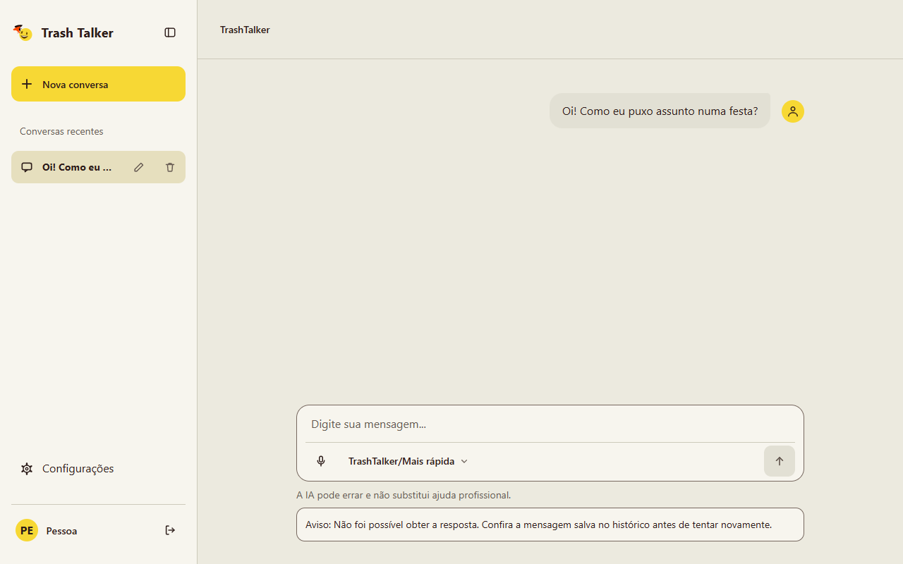
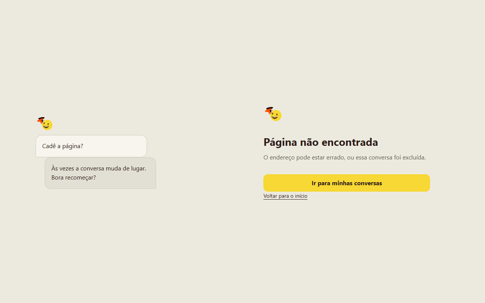

## 9. Seus dados
O que é guardado, com quem é compartilhado e seus direitos estão na
**Política de Privacidade** (rodapé do site e Configurações). Resumo: as
mensagens vão ao Google Gemini para gerar as respostas; você pode exportar
ou apagar tudo a qualquer momento.

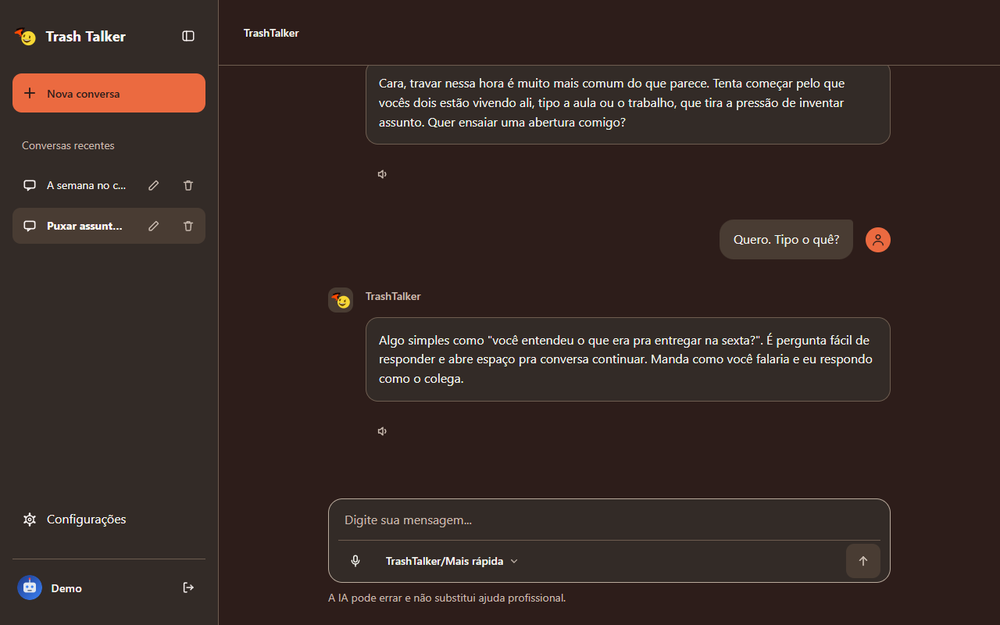
