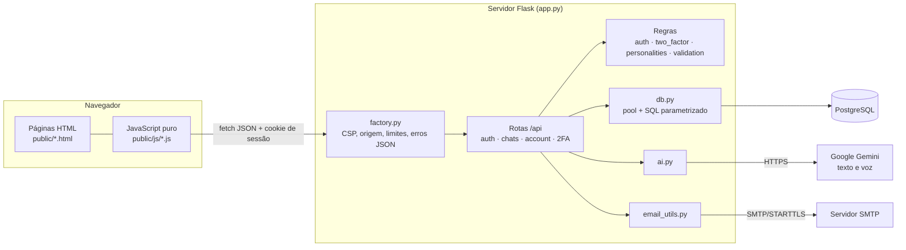
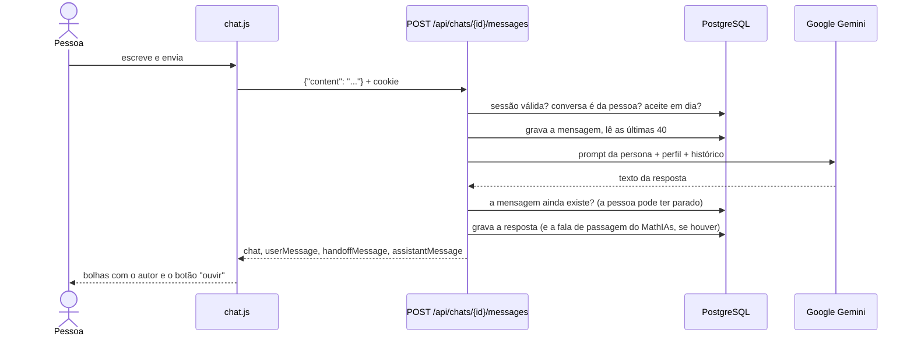
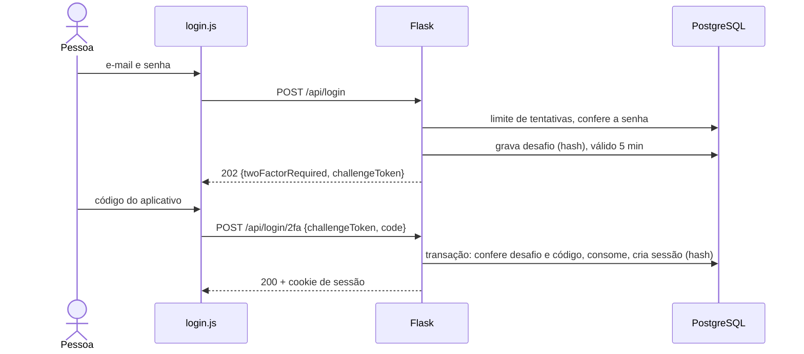
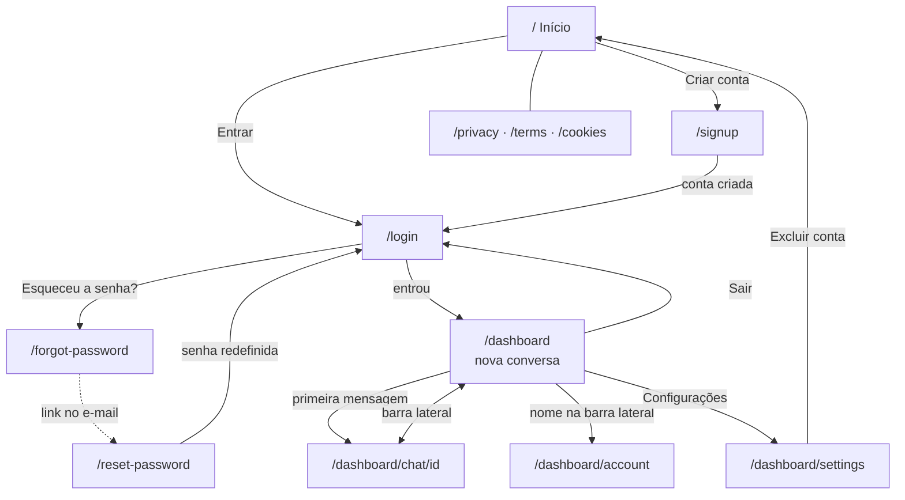

# Manual técnico

Como o Trash Talker é construído, como as partes conversam e como manter.
Instalação passo a passo: [`README.md`](../README.md). Banco:
[`banco-de-dados.md`](banco-de-dados.md). Segurança: [`seguranca.md`](seguranca.md).

## 1. Arquitetura

Aplicação **cliente-servidor**, multipágina, sem framework de frontend e sem
etapa de build:

- **Cliente (navegador):** 13 páginas HTML estáticas em `public/` + JavaScript
  puro (`public/js/`). Cada página busca os dados de que precisa na API com
  `fetch()` (JSON) e monta a tela; a navegação entre páginas é "de verdade"
  (não é SPA).
- **Servidor:** Flask (Python), que expõe uma API JSON em `/api/*` e, em
  desenvolvimento, também serve as páginas. Em produção (Vercel) as páginas
  saem da CDN e o Flask roda como função serverless só para `/api/*`.
- **Banco:** PostgreSQL, acessado só pelo servidor, com SQL parametrizado.
- **Serviços externos:** Google Gemini (respostas e áudio) e SMTP (e-mail de
  redefinição), chamados só pelo servidor - chaves nunca chegam ao navegador.

### Fluxo de dados: enviar uma mensagem

### Fluxo de dados: entrar com 2FA

## 2. Módulos

### Servidor (`backend/`)
| Módulo | Responsabilidade |
|---|---|
| `factory.py` | Cria o app: registra rotas, páginas, CSP e cabeçalhos, bloqueio de POST de outra origem, limite de 1 MB, erros da API em JSON, página 404. |
| `routes/auth_api.py` | Cadastro, login, logout, `/me`, esqueci/redefinir senha. |
| `routes/two_factor_api.py` | Rotas do 2FA (regras em `two_factor.py`). |
| `routes/chats_api.py` | Painel, conversas, mensagens, parar, persona/esforço, TTS. |
| `routes/account_api.py` | Perfil, troca de senha, aceite, exportação, exclusão. |
| `auth.py` | Hash de senha, sessões e tokens (guardados como hash), política de senha, consentimento, limite de tentativas, `@require_auth`. |
| `two_factor.py` | TOTP, códigos de recuperação, desafios, bloqueios - tudo em transação. |
| `validation.py` | Leitura defensiva do corpo JSON (`json_body`, `text_field`). |
| `db.py` | Pool de conexões, `query`/`query_one`/`execute`, nova tentativa em conexão derrubada, `get_owned_chat`. |
| `ai.py` | Chamada ao Gemini (texto, com níveis de esforço) e ao Gemini TTS (áudio WAV). |
| `personalities.py` | Prompts do TrashTalker e do MathIAs, seção de segurança comum, regra de "preguiça". |
| `email_utils.py` | E-mail de redefinição via SMTP (biblioteca padrão). |
| `avatars.py` | Lista dos avatares ilustrados. |
| `schema.sql` | Esquema do banco (idempotente). |

### Cliente (`public/js/`)
| Arquivo | Responsabilidade |
|---|---|
| `api.js` | `apiFetch` (JSON, erros com mensagem do servidor), `getDashboard` compartilhado, `withLoadingState`. |
| `ui.js` | Acessibilidade comum, mostrar/ocultar senha, aviso de cookies, `showUIMessage`. |
| `theme.js` | Tema claro/escuro antes da primeira pintura. |
| `layout.js` | Barra lateral, guarda de autenticação (401 → `/login`), renomear/excluir, janela de novo aceite. |
| `chat.js` | Campo de mensagem, envio, parar, histórico com autor, seletor de persona. |
| `personality-picker.js` | Menu de persona/esforço (acessível por teclado). |
| `voice.js` | Ditado (Web Speech API) e "ouvir" (Gemini TTS com reserva no navegador). |
| `login.js`, `signup.js`, `auth.js` | Formulários de entrada, cadastro, senha e confirmações. |
| `account.js`, `avatar.js` | Perfil; avatar montado por DOM (sem HTML em texto). |
| `settings.js`, `two-factor.js` | Configurações, senha, exportação, exclusão, 2FA. |
| `modal.js` | Janela de confirmação acessível (foco preso, Esc). |
| `landing.js` | Página inicial adapta botões à sessão. |

## 3. API

Todas as rotas respondem JSON. Erros: `{"error": "mensagem"}` com o status
HTTP adequado. Rotas marcadas com 🔒 exigem o cookie de sessão
(`session_token`); sem ele, **401**. Todo `POST` vindo de outra origem
recebe **403**; corpo acima de 1 MB, **413**.

### Autenticação
| Método | Rota | Corpo | Sucesso | Erros principais |
|---|---|---|---|---|
| GET | `/api/me` 🔒 | — | 200 `{user}` | 401 |
| POST | `/api/signup` | `email, name, password, acceptTerms, acceptAi` | 201 `{ok}` | 400 validação, 409 e-mail em uso |
| POST | `/api/login` | `email, password` | 200 `{user}` + cookie · 202 `{twoFactorRequired, challengeToken, expiresIn}` | 400, 401, 429 (+`Retry-After`), 503 (2FA indisponível) |
| POST | `/api/login/2fa` | `challengeToken, code` | 200 `{user}` + cookie | 400 (`code`: `invalid_two_factor_code`/`challenge_expired`), 429 |
| POST | `/api/logout` | — | 200 `{ok}` | — |
| POST | `/api/forgot-password` | `email` | 200 `{ok}` (sempre) | 400 tipo inválido |
| POST | `/api/reset-password` | `token, newPassword` | 200 `{ok}` | 400 senha fraca ou link inválido |

### Autenticação em dois fatores (POST exige `Content-Type: application/json`)
| Método | Rota | Corpo | Sucesso |
|---|---|---|---|
| GET | `/api/2fa/status` 🔒 | — | `{enabled, available, recoveryCodesRemaining}` |
| POST | `/api/2fa/setup` 🔒 | `password` | `{manualKey, qrCodeDataUrl, expiresIn}` |
| POST | `/api/2fa/confirm` 🔒 | `code` | `{enabled: true, recoveryCodes}` + cookie novo |
| POST | `/api/2fa/disable` 🔒 | `password, code` | `{enabled: false}` + cookie novo |
| POST | `/api/2fa/recovery-codes` 🔒 | `password, code` | `{enabled: true, recoveryCodes}` + cookie novo |

### Conversas
| Método | Rota | Corpo | Sucesso | Erros principais |
|---|---|---|---|---|
| GET | `/api/dashboard` 🔒 | — | `{user, chats, illustratedAvatars, personalities, efforts, needsConsent}` | — |
| POST | `/api/chats` 🔒 | `personality?, effort?` | 201 `{id}` | — |
| GET | `/api/chats/<id>` 🔒 | — | `{chat, messages}` | 404 |
| POST | `/api/chats/<id>/messages` 🔒 | `content` | `{chat, userMessage, handoffMessage, assistantMessage}` ou `{cancelled: true}` | 400, 403 (`needsConsent`), 404, 502 (IA) |
| POST | `/api/chats/<id>/cancel` 🔒 | — | `{ok}` | 404 |
| POST | `/api/chats/<id>/title` 🔒 | `title` | `{ok}` | 400, 404 |
| POST | `/api/chats/<id>/personality` 🔒 | `personality` | `{ok}` | 400, 404 |
| POST | `/api/chats/<id>/effort` 🔒 | `effort` | `{ok}` | 400, 404 |
| POST | `/api/chats/<id>/delete` 🔒 | — | `{ok}` | 404 |
| POST | `/api/tts` 🔒 | `text, personality?` | áudio `audio/wav` | 400, 403, 502 |

### Conta
| Método | Rota | Corpo | Sucesso | Erros principais |
|---|---|---|---|---|
| POST | `/api/account` 🔒 | `name, image?, displayName?, pronoun?, interests?` | `{ok, user}` | 400 |
| POST | `/api/account/password` 🔒 | `currentPassword, newPassword` | `{ok}` | 400, 401 |
| POST | `/api/account/consent` 🔒 | `acceptTerms, acceptAi` | `{ok}` | 400 |
| GET | `/api/account/export` 🔒 | — | JSON completo dos dados | — |
| POST | `/api/account/delete` 🔒 | `password, confirmation` | `{ok}` + cookie apagado | 400 frase, 401 senha |

### Páginas
`/`, `/login`, `/signup`, `/forgot-password`, `/reset-password`, `/privacy`,
`/terms`, `/cookies`, `/dashboard`, `/dashboard/account`,
`/dashboard/settings`, `/dashboard/chat/<id>`; `/dashboard/information`
redireciona para `/`; qualquer outra → `public/404.html` (404).

Fluxo de navegação (as páginas legais são acessíveis de todas as telas pelo
rodapé ou pelas Configurações; sem sessão, qualquer página do painel leva
ao login):

## 4. Autenticação e persistência

- **Sessão:** ao entrar, o servidor gera um token aleatório de 256 bits,
  envia no cookie `session_token` (`httponly`, `SameSite=Lax`, `Secure` em
  produção) e guarda **só o SHA-256** em `sessions`. Cada rota protegida
  (`@require_auth`) faz uma consulta (sessão + usuário) e preenche `g.user`.
- **Transações:** cada `query`/`execute` é uma transação curta; o 2FA usa
  transação explícita com `FOR UPDATE`. Conexões derrubadas pelo Neon são
  descartadas e a operação é repetida uma vez (`db._with_retry`).
- **Estado no cliente:** só preferências no `localStorage` (tema, barra
  lateral recolhida, aviso de cookies). Nenhum token fica acessível ao JavaScript.

## 5. Configuração

Todas as variáveis estão comentadas em [`.env.example`](../.env.example).

| Variável | Obrigatória | Efeito se faltar |
|---|---|---|
| `DATABASE_URL` | sim | A aplicação não sobe. |
| `GEMINI_API_KEY` | para a IA | Enviar mensagem → 502 com aviso; o resto funciona. |
| `TOTP_ENCRYPTION_KEY` | para 2FA | 2FA indisponível (503); contas com 2FA não conseguem entrar. **Nunca troque nem perca.** |
| `FRONTEND_ORIGIN` | em produção | Link do e-mail aponta para `localhost`; checagem de origem usa só o host da requisição. |
| `SMTP_*` | para e-mail | Link de redefinição só no terminal (fora de produção). |
| `FLASK_ENV=production` | em produção | Cookie sem `Secure` (na Vercel `VERCEL=1` já liga). |
| `HOST`, `PORT`, `FLASK_DEBUG` | não | Padrão seguro: `127.0.0.1:5000`, sem debugger. |

Constantes de regra de negócio (limites, prazos) ficam no topo dos módulos
(`auth.py`, `chats_api.py`, `account_api.py`, `personalities.py`, `ai.py`) e
estão listadas em `requisitos.md` (RN01-RN22).

## 6. Manutenção

| Tarefa | Como |
|---|---|
| Atualizar o banco após nova versão | `psql "$DATABASE_URL" -v ON_ERROR_STOP=1 -f backend/schema.sql` (idempotente) |
| Mudar os termos/política | Editar as páginas e trocar `CONSENT_VERSION` em `auth.py` → todos aceitam de novo |
| Nova persona | Entrada em `PERSONALITIES` + voz em `ai.TTS_VOICES` + logo no `chat.js`; rodar `tools/avaliar_ia.py` |
| Trocar modelo do Gemini | `EFFORTS`/`TTS_MODEL` em `ai.py`; conferir com `tools/check_gemini_tier.py` e reavaliar a IA |
| Logs | `logging` padrão (na Vercel, aba *Logs*). Erros inesperados saem com traceback; a resposta ao cliente nunca traz detalhe |
| Verificar antes de entregar | `docs/processo.md`, "Definição de pronto" |
| Publicar | [`DEPLOY_VERCEL.md`](../DEPLOY_VERCEL.md) |
